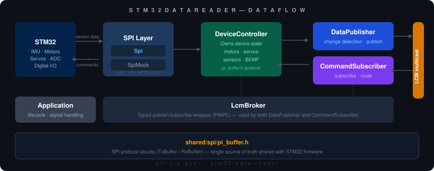

<div align="center">


# stm32-data-reader

**Raspberry Pi ↔ STM32 SPI bridge — reads sensor data and publishes it via LCM for RaccoonOS.**

[](https://github.com/htl-stp-ecer/stm32-data-reader/actions/workflows/build-release.yml)
[](https://github.com/htl-stp-ecer/stm32-data-reader/releases/latest)
[](COPYING)


> 📖 **Full documentation at [raccoon-docs.pages.dev](https://raccoon-docs.pages.dev/)**

</div>

---

This service runs on the Raspberry Pi inside the [KIPR Wombat](https://www.kipr.org/kipr/hardware-software) and acts as the hardware bridge between the STM32 microcontroller and the rest of RaccoonOS. It communicates with the STM32 over SPI, reads IMU, analog, and digital sensor data, and publishes everything onto the LCM multicast bus — where [RaccoonLib](https://github.com/htl-stp-ecer/raccoon-lib) and [botui](https://github.com/htl-stp-ecer/botui) can consume it. Motor and servo commands flow the other way: received from LCM and forwarded to the STM32.

---

## What it bridges

**Publishes (STM32 → LCM):**
- IMU — gyroscope, accelerometer, magnetometer, orientation quaternion, calibration accuracy
- Analog inputs (6 ports), digital inputs (16-bit)
- Motor back-EMF readings (4 ports)
- System — battery voltage, IMU temperature, CPU temperature

**Subscribes (LCM → STM32):**
- Motor power and stop commands (4 ports)
- Servo position commands (4 ports)
- BEMF reset, scale, and offset commands

Full channel reference: see [LCM Channels](#lcm-channels) below.

---

## Building

Reader and firmware are cross compiled for the Pi in Docker on your PC at native speed (no emulation). You only need Docker and Python 3.

```bash
python3 build.py                  # reader + firmware -> builds/stm32-data-reader_0.0_arm64.deb
python3 build.py --version 60     # release build (what CI does)
python3 build.py --test           # also build the unit tests and run them with qemu-user
python3 build.py --skip-firmware  # reuse the firmware of the last build
```

Output: `builds/stm32-data-reader_<version>_arm64.deb` (the reader, the STM32 firmware with its flash scripts, the systemd units) and `builds/manifest.json`. Measured: about 50 seconds from scratch (without cache), a few seconds with the cache.

### Local build (mock SPI, no hardware needed)

```bash
mkdir -p cmake-build-debug && cd cmake-build-debug
cmake .. -DUSE_SPI_MOCK=ON -DCMAKE_BUILD_TYPE=Debug
cmake --build . -j$(nproc)
```

| CMake option | Default | Description |
|:-------------|:--------|:------------|
| `USE_SPI_MOCK` | `ON` | Mock SPI — build and test without hardware |
| `CMAKE_BUILD_TYPE` | `Release` | `Release`, `Debug`, `RelWithDebInfo` |

---

## Deployment

### Install a release (recommended)

Each [release](https://github.com/htl-stp-ecer/stm32-data-reader/releases/latest) ships
`stm32-data-reader_<number>_arm64.deb`. `raccoon update` installs it, or on the Pi:

```bash
sudo apt install ./stm32-data-reader_<number>_arm64.deb
```

That installs the reader to `/usr/bin`, the firmware with its flash scripts to `/usr/lib/stm32-data-reader/firmware`, flashes the STM32 when the hardware is there and starts the services.

### Dev deploy (from source)

```bash
python3 deploy.py --host <your-pi-ip>     # installs builds/*.deb, flashes the firmware
```

`deploy.py` copies the `.deb` from `builds/` (made by `build.py`) to the Pi, sets `stm32-data-reader` to `dev` in `/etc/raccoon-bundle.json` (a deployed build is a custom build) and installs it with `apt`. The package installs the units, flashes the firmware and restarts the reader, so every deploy flashes the STM32 again.

### Running as a systemd service

```bash
sudo systemctl enable --now stm32_data_reader
journalctl -u stm32_data_reader -f
```

---

## Firmware

The STM32 firmware lives in `firmware/` and shares the SPI protocol header (`shared/spi/pi_buffer.h`) with the reader — single source of truth for both sides.

```bash
# Reader and firmware together, in Docker
python3 build.py

# Build firmware natively (requires gcc-arm-none-eabi)
cd firmware && mkdir -p build && cd build
cmake -G "Unix Makefiles" -DCMAKE_TOOLCHAIN_FILE=../CMake/GNU-ARM-Toolchain.cmake ..
cmake --build . -- -j$(nproc)
```

`python3 build.py` builds reader and firmware together (the firmware in `Dockerfile.firmware`). `python3 deploy.py --host <pi>` installs the package, which flashes the firmware to the STM32.

---

## Architecture

<div align="center">
  
</div>

| Component | What it does |
|:----------|:-------------|
| `Application` | Main orchestrator — lifecycle, signal handling |
| `DeviceController` | Owns SPI state: motors, servos, sensors |
| `DataPublisher` | Publishes sensor data to LCM with change detection |
| `CommandSubscriber` | Receives LCM commands and routes to DeviceController |
| `LcmBroker` | Typed publish/subscribe wrapper (PIMPL pattern) |
| `Spi` / `SpiMock` | Hardware abstraction toggled via `USE_SPI_MOCK` |

---

## LCM Channels

### Published (sensor data)

| Channel | Type | Description |
|:--------|:-----|:------------|
| `libstp/gyro/value` | `vector3f_t` | Gyroscope (rad/s) |
| `libstp/accel/value` | `vector3f_t` | Accelerometer (m/s²) |
| `libstp/mag/value` | `vector3f_t` | Magnetometer |
| `libstp/imu/quaternion` | `quaternion_t` | Orientation quaternion |
| `libstp/imu/temp/value` | `scalar_f_t` | IMU temperature (°C) |
| `libstp/cpu/temp/value` | `scalar_f_t` | CPU temperature (°C) |
| `libstp/battery/voltage` | `scalar_f_t` | Battery voltage |
| `libstp/analog/{0-5}/value` | `scalar_i32_t` | Analog sensor readings |
| `libstp/digital/{0-15}/value` | `scalar_i32_t` | Digital input states |
| `libstp/bemf/{0-3}/value` | `scalar_i32_t` | Motor back-EMF |
| `libstp/gyro/accuracy` | `scalar_i8_t` | Gyro calibration status (0–3) |
| `libstp/accel/accuracy` | `scalar_i8_t` | Accelerometer calibration status |
| `libstp/mag/accuracy` | `scalar_i8_t` | Magnetometer calibration status |
| `libstp/imu/quaternion_accuracy` | `scalar_i8_t` | Quaternion accuracy |

### Subscribed (commands)

| Channel | Type | Description |
|:--------|:-----|:------------|
| `libstp/motor/{0-3}/power_cmd` | `scalar_i32_t` | Motor power (−100 to 100) |
| `libstp/motor/{0-3}/stop_cmd` | `scalar_i32_t` | Stop motor |
| `libstp/servo/{0-3}/position_cmd` | `scalar_i32_t` | Servo position |
| `libstp/bemf/{0-3}/reset_cmd` | `scalar_i32_t` | Reset BEMF accumulator |
| `libstp/bemf/{0-3}/scale_cmd` | `scalar_f_t` | BEMF scale factor |
| `libstp/bemf/{0-3}/offset_cmd` | `scalar_f_t` | BEMF offset |
| `libstp/bemf/nominal_voltage_cmd` | `scalar_i32_t` | Nominal battery voltage |
| `libstp/system/dump_request` | `scalar_i32_t` | Request full data dump |

---

## Network setup for LCM

LCM uses UDP multicast. Enable the loopback route for local-only operation:

```bash
sudo systemctl enable --now lcm-loopback-multicast
# or manually:
sudo ip route add 239.255.76.67/32 dev lo
```

For network operation, ensure multicast is enabled and UDP port 7667 is open.

---

## Project structure

```
stm32-data-reader/
├── src/wombat/
│   ├── Application.cpp
│   ├── services/            # DataPublisher, CommandSubscriber, DeviceController
│   ├── hardware/            # Spi, SpiMock
│   ├── messaging/           # LcmBroker
│   └── core/                # Logger, Result<T>, utilities
├── include/wombat/          # Headers matching src/
├── shared/spi/pi_buffer.h   # SPI protocol (shared with STM32 firmware)
├── firmware/                # STM32 firmware source
├── lcm-messages/types/      # LCM message definitions (.lcm files)
├── systemd/                 # Service files
├── packaging/debian/        # control and maintainer scripts of the .deb
├── build.py                 # Cross-compiles reader + firmware in Docker, makes the .deb (builds/)
├── deploy.py                # Installs the .deb on a Pi (development)
├── Dockerfile               # aarch64 cross compiler for the reader
└── Dockerfile.firmware      # arm-none-eabi-gcc for the firmware
```

---

## Part of RaccoonOS

| Repository | What it is |
|:-----------|:-----------|
| [raccoon-lib](https://github.com/htl-stp-ecer/raccoon-lib) | Core robotics library — consumes LCM data published here |
| [raccoon-transport](https://github.com/htl-stp-ecer/raccoon-transport) | Shared LCM message types |
| [botui](https://github.com/htl-stp-ecer/botui) | Flutter UI — visualises sensor data from this service |
| [documentation](https://raccoon-docs.pages.dev/) | Full platform docs |

---

## License

Copyright (C) 2026 Tobias Madlberger  
Licensed under the GNU General Public License v3.0 — see [COPYING](COPYING) for details.
