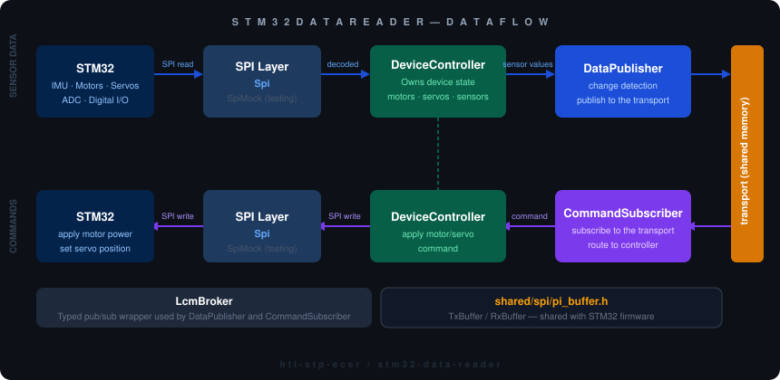

<div align="center">


# stm32-data-reader

**Raspberry Pi ↔ STM32 SPI bridge — reads sensor data and publishes it on the raccoon-transport bus for RaccoonOS.**

[](COPYING)


[](https://github.com/htl-stp-ecer/stm32-data-reader/actions/workflows/build-release.yml)
[](https://github.com/htl-stp-ecer/stm32-data-reader/releases/latest)

> 📖 **Full documentation at [raccoon-docs.pages.dev](https://raccoon-docs.pages.dev/)**

</div>

---

This service runs on the Raspberry Pi inside the [KIPR Wombat](https://www.kipr.org/kipr/hardware-software) and acts as the hardware bridge between the STM32 microcontroller and the rest of RaccoonOS. It communicates with the STM32 over SPI, reads IMU, analog, and digital sensor data, and publishes everything via [raccoon-transport](https://github.com/htl-stp-ecer/raccoon-transport) (shared-memory ring under `/dev/shm`) — where [raccoon-lib](https://github.com/htl-stp-ecer/raccoon-lib) and [botui](https://github.com/htl-stp-ecer/botui) can consume it. Motor and servo commands flow the other way: received from the bus and forwarded to the STM32.

---

## What it bridges

**Publishes (STM32 → bus):**
- IMU — gyroscope, accelerometer, linear acceleration, magnetometer, orientation quaternion, heading, calibration accuracy
- Odometry computed on the STM32 — position, heading, velocities
- Analog inputs (6 ports), digital inputs
- Motor power, position and back-EMF, servo mode and position (4 ports each)
- System — battery voltage, IMU temperature, CPU temperature, shutdown status

**Subscribes (bus → STM32):**
- Motor commands per port — power, mode, stop, velocity, position, PID, position reset
- Servo commands per port — position, mode, smooth position
- Chassis velocity command (the firmware runs the wheel loop on the MCU)
- Kinematics config, odometry reset, BEMF scale, offset and enable, shutdown

Full channel reference: see [Channels](#channels) below.

---

## Building

Reader and firmware are cross compiled for the Pi in Docker on your PC at native speed (no emulation). You only need Docker and Python 3.

```bash
python3 build.py                  # reader + firmware -> builds/stm32-data-reader_0.0_arm64.deb
python3 build.py --version 60     # release build (what CI does)
python3 build.py --test           # also build the unit tests and run them with qemu-user
python3 build.py --skip-firmware  # reuse the firmware of the last build
```

Output: `builds/stm32-data-reader_<version>_arm64.deb` (the reader, the STM32 firmware with its flash scripts, the systemd units) and `builds/manifest.json`. Measured: about 50 seconds from scratch (without cache), a few seconds with the cache.

### Local build (mock SPI, no hardware needed)

```bash
mkdir -p cmake-build-debug && cd cmake-build-debug
cmake .. -DUSE_SPI_MOCK=ON -DCMAKE_BUILD_TYPE=Debug
cmake --build . -j$(nproc)
```

| CMake option | Default | Description |
|:-------------|:--------|:------------|
| `USE_SPI_MOCK` | `ON` | Mock SPI — build and test without hardware |
| `CMAKE_BUILD_TYPE` | `Release` | `Release`, `Debug`, `RelWithDebInfo` |

---

## Deployment

### Install a release (recommended)

Each [release](https://github.com/htl-stp-ecer/stm32-data-reader/releases/latest) ships
`stm32-data-reader_<number>_arm64.deb`. `raccoon update` installs it, or on the Pi:

```bash
sudo apt install ./stm32-data-reader_<number>_arm64.deb
```

That installs the reader to `/usr/bin`, the firmware with its flash scripts to `/usr/lib/stm32-data-reader/firmware`, flashes the STM32 when the hardware is there and starts the services.

### Dev deploy (from source)

```bash
python3 deploy.py --host <your-pi-ip>     # installs builds/*.deb, flashes the firmware
```

`deploy.py` copies the `.deb` from `builds/` (made by `build.py`) to the Pi, sets `stm32-data-reader` to `dev` in `/etc/raccoon-bundle.json` (a deployed build is a custom build) and installs it with `apt`. The package installs the units, flashes the firmware and restarts the reader, so every deploy flashes the STM32 again.

### Running as a systemd service

```bash
sudo systemctl enable --now stm32_data_reader
journalctl -u stm32_data_reader -f
```

---

## Firmware

The STM32 firmware lives in `firmware/` and shares the SPI protocol header (`shared/spi/pi_buffer.h`) with the reader — single source of truth for both sides.

```bash
# Reader and firmware together, in Docker
python3 build.py

# Build firmware natively (requires gcc-arm-none-eabi)
cd firmware && mkdir -p build && cd build
cmake -G "Unix Makefiles" -DCMAKE_TOOLCHAIN_FILE=../CMake/GNU-ARM-Toolchain.cmake ..
cmake --build . -- -j$(nproc)
```

`python3 build.py` builds reader and firmware together (the firmware in `Dockerfile.firmware`). `python3 deploy.py --host <pi>` installs the package, which flashes the firmware to the STM32. When the firmware has to be flashed again, the reader first sends a warning (`messages/warn`) to the UI: the flash blocks for about a minute, during which the robot does not react. The firmware's boot log shows whether the flash runs single-bank or dual-bank (the `DB1M` option bit).

---

## Architecture

<div align="center">
  
</div>

| Component | What it does |
|:----------|:-------------|
| `Application` | Main orchestrator — lifecycle, signal handling |
| `DeviceController` | Owns SPI state: motors, servos, sensors |
| `DataPublisher` | Publishes sensor data with change detection |
| `CommandSubscriber` | Receives commands and routes them to DeviceController |
| `LcmBroker` | Typed publish/subscribe wrapper around `raccoon::Transport` (PIMPL pattern) |
| `Spi` / `SpiMock` | Hardware abstraction toggled via `USE_SPI_MOCK` |

---

## Channels

Channel names and their message types come from the channel table of [raccoon-transport](https://github.com/htl-stp-ecer/raccoon-transport) (`channels.yml`). `{n}` is the port number. A channel is retained when a new subscriber gets its latest frame, and reliable when the sender repeats a frame until the receiver acknowledges it.

### Published

| Channel | Type | Description |
|:--------|:-----|:------------|
| `hardware/imu/state/gyro` | `vector3f_t` | Gyroscope (rad/s) |
| `hardware/imu/state/accel` | `vector3f_t` | Accelerometer (m/s²) |
| `hardware/imu/state/linear_accel`, `accel_velocity`, `mag` | `vector3f_t` | Linear acceleration, velocity from acceleration, magnetometer |
| `hardware/imu/state/quaternion` | `quaternion_t` | Orientation quaternion |
| `hardware/imu/state/heading` | `scalar_f_t` | Heading |
| `hardware/imu/state/temperature` | `scalar_f_t` | IMU temperature (°C) |
| `hardware/imu/state/{gyro,accel,mag,quaternion}_accuracy` | `scalar_i8_t` | Calibration status (0–3) |
| `system/state/cpu_temperature` | `scalar_f_t` | CPU temperature (°C) |
| `hardware/battery/state/voltage` | `scalar_f_t` | Battery voltage |
| `hardware/odometry/state/{pos_x,pos_y,heading,vx,vy,wz}` | `scalar_f_t` | Odometry from the STM32 |
| `hardware/analog/{n}/state/value` | `scalar_i32_t` | Analog sensor readings |
| `hardware/digital/{n}/state/value` | `scalar_i32_t` | Digital input states |
| `hardware/motor/{n}/state/power` | `scalar_i32_t` | Current motor power |
| `hardware/motor/{n}/state/position` | `scalar_i32_t` | Motor position |
| `hardware/motor/{n}/state/bemf` | `scalar_i32_t` | Motor back-EMF |
| `hardware/servo/{n}/state/{mode,position,feedback,health,done}` | | Servo state |
| `hardware/latch/state/flags` | `scalar_i32_t` | Flags of the motor latch (see below) |
| `hardware/feature/state/bemf_active` | `scalar_i32_t` | Whether back-EMF control is active |
| `messages/error`, `messages/warn` | `message_t` | Errors and warnings of the reader (the same text at most once per second) |

### Subscribed (commands)

| Channel | Type | Description |
|:--------|:-----|:------------|
| `hardware/motor/{n}/cmd/power` | `scalar_i32_t` | Motor power (−100 to 100) |
| `hardware/motor/{n}/cmd/mode` | `scalar_i32_t` | Motor mode |
| `hardware/motor/{n}/cmd/stop` | `scalar_i32_t` | Stop motor |
| `hardware/motor/{n}/cmd/velocity` | `scalar_i32_t` | Target velocity |
| `hardware/motor/{n}/cmd/position` | `vector3f_t` | Move to position (`x` = speed limit, `y` = goal) |
| `hardware/motor/{n}/cmd/pid` | `vector3f_t` | PID gains |
| `hardware/motor/{n}/cmd/reset_position` | `scalar_i32_t` | Reset the position counter (non-zero value) |
| `hardware/chassis/cmd/velocity` | `vector3f_t` | Body-frame velocity (vx, vy, wz), a stream |
| `hardware/chassis/cmd/stop` | `scalar_i32_t` | Stop the chassis (reliable) |
| `hardware/servo/{n}/cmd/{position,mode,smooth,velocity}` | | Servo commands |
| `hardware/kinematics/cmd/config` | `kinematics_config_t` | Kinematics matrices |
| `hardware/odometry/cmd/reset` | `scalar_i32_t` | Reset odometry |
| `hardware/latch/cmd/engaged` | `scalar_i32_t` | Engage (non-zero) or release (0) the motor latch |
| `hardware/feature/cmd/bemf_active` | `scalar_i32_t` | Switch back-EMF control on or off |
| `hardware/watchdog/cmd/heartbeat` | `scalar_i32_t` | Heartbeat of the program, feeds the motor watchdog |

The commands of the motors and servos, the chassis stop, the latch and the kinematics are reliable.

The motor watchdog engages the latch when the heartbeat stops for 500 ms, and releases it after three heartbeats in a row. While the latch is engaged by `hardware/latch/cmd/engaged`, the watchdog neither fires nor releases it. `hardware/latch/state/flags` reports which of the two engaged the latch.

---

## Transport

The reader publishes and subscribes through `raccoon::Transport`, which uses one shared-memory file per channel under `/dev/shm/raccoon-rings/`. No network setup is needed. The reader checks the transport contract hash at startup and exits with code 78 if it does not match the installed bundle.

---

## Project structure

```
stm32-data-reader/
├── src/wombat/
│   ├── Application.cpp
│   ├── services/            # DataPublisher, CommandSubscriber, DeviceController, MotorWatchdog, SystemMonitor, UartMonitor
│   ├── hardware/            # Spi, SpiReal, SpiMock
│   ├── messaging/           # LcmBroker (wraps raccoon::Transport)
│   └── core/                # Logger, Result<T>, CmdTrace, version checks
├── include/wombat/          # Headers matching src/
├── shared/spi/pi_buffer.h   # SPI protocol (shared with STM32 firmware)
├── firmware/                # STM32 firmware source
├── raccoon-transport/       # Messages and channels (git submodule)
├── scripts/                 # Tools, e.g. pid_tune.py
├── docs/                    # Architecture diagram
├── systemd/                 # Service files
├── packaging/debian/        # control and maintainer scripts of the .deb
├── build.py                 # Cross-compiles reader + firmware in Docker, makes the .deb (builds/)
├── deploy.py                # Installs the .deb on a Pi (development)
├── Dockerfile               # aarch64 cross compiler for the reader
└── Dockerfile.firmware      # arm-none-eabi-gcc for the firmware
```

---

## License

Copyright (C) 2026 Tobias Madlberger  
Licensed under the GNU General Public License v3.0 — see [COPYING](COPYING) for details.
